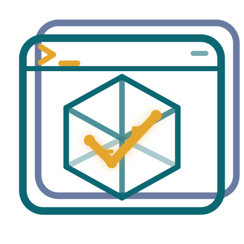

# Proteus (`@bastionfold/proteus`)



**Live Multi-Model Boardroom AI Agent CLI**  
*Built by [Bastion Fold LLC](https://github.com/BastionFold)*

[](https://opensource.org/licenses/MIT)

Proteus orchestrates frontier AI models into a collaborative digital boardroom. Rather than relying on a single fallible LLM, Proteus assigns specialized seats—**Chair**, **Code**, **Security**, and **Reasoning**—to cross-examine logic, audit code, and vote on critical decisions.

---

## The Boardroom Structure

| Role | Default Model | Responsibility |
|---|---|---|
| **Chair** | `gpt-oss-120b` | Moderates discussions, synthesizes perspectives, owns tool execution. |
| **Code** | `qwen3.8-27b` | Drafts and refines code implementations. |
| **Security** | `gpt-oss-safeguard-20b` | Audits for vulnerabilities, data leaks, and attack vectors. |
| **Reasoning** | `gpt-oss-20b` | Multi-step inference, edge-case probing, and trade-off analysis. |

---

## Quick Start

### Installation

```bash
npm install -g @bastionfold/proteus
```

*Or run directly via npx:*
```bash
npx @bastionfold/proteus boardroom
```

### Basic Usage

```bash
# Start an interactive boardroom deliberation
proteus boardroom

# Run a structured debate on an architectural decision
proteus debate "Should we migrate our authentication to passkeys?"

# Convene a formal quorum vote
proteus vote "Approve pull request #42 release notes"
```

---

## Deliberation Modes

- **SOLO**: Single-agent execution when rapid responses are needed.
- **DEBATE**: Triggered on architectural questions and trade-offs.
- **ROUND_TABLE**: Circular multi-turn evaluation across all seats.
- **VOTE**: Consensus calculation with absent-member fallback policies.

---

## Architecture & System Links

Proteus is part of the **Bastion Fold** sovereign agent ecosystem:
- **Parent System**: [`BastionFold/proteus-system`](https://github.com/BastionFold/proteus-system)
- **Engine Core**: [`BastionFold/aion-proteus-hub`](https://github.com/BastionFold/aion-proteus-hub)
- **Local Voicemail Sibling**: [`BastionFold/aion`](https://github.com/BastionFold/aion)

---

## License

MIT © [Bastion Fold LLC](https://github.com/BastionFold) — Member Alexander Sorrell.
