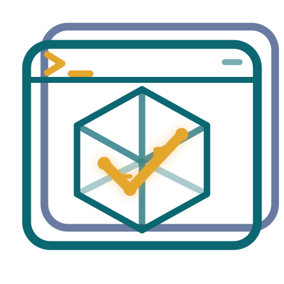

## Proteus

**Status:** In development

Frontier cloud models in a structured boardroom — Chair, Code, Security, and Reasoning seats cross-examining every answer. Bring your own API keys, with a hard spend cap on each one.

### What's new
- OMNICLI routing across Claude, GPT, Gemini, DeepSeek, and Groq
- Per-key budget caps so there are never surprise bills
